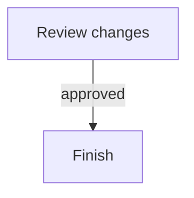

# Merstride

Merstride is a small native CLI that executes workflows embedded in Markdown.
Mermaid defines control flow; YAML defines process commands, agent tasks and
terminal results. Use it for repeatable checks, repair loops and reviews while
keeping the workflow readable alongside your project documentation.

Execution is sequential and deterministic. Merstride runs process nodes until it
reaches an agent task, a terminal node or an error, then saves progress locally.
Your existing coding agent receives an explicit request with a literal prompt,
selected context and allowed outcomes. It performs the task with its own tools
and returns an outcome. Merstride has no built-in LLM integration, API key or
model session; you or your agent explicitly call `advance` to continue.

Commands print readable English text by default, including redirected output.
For example, `merstride creation-guide` prints a copyable authoring guide directly.
Agents and scripts must pass `--json` explicitly for the unchanged protocol-1
response; existing callers that relied on default JSON must add that flag.
During `advance`, live activity on stderr identifies the run and active node,
then shows saved outcomes/routes and agent or terminal transitions. Final summaries
stay on stdout. This also works when output is redirected; `--json` suppresses activity.

## Quick start

A small workflow asks your existing agent to review changes, then finishes when
it returns `approved`. Save both blocks together as `workflow.md`:



```yaml merstride
schemaVersion: 1
id: quick_start
entry: review
nodes:
  review:
    kind: agent
    prompt: Review the current changes and return approved when ready.
  done:
    kind: end
    result: success
```

For binary downloads and platform requirements, see
[download and run](docs/RELEASING.md#download-and-run). Releases use SemVer tags
and GitHub Actions. Windows x64 and Linux x64 have local verification. The macOS
15+ Apple Silicon build, native acceptance, packaging and extracted-archive tests
without system .NET passed on GitHub-hosted runners; see [current evidence](docs/STATUS.md).
Overall release qualification and publication remain incomplete.

Build from source using the [development prerequisites and build instructions](CONTRIBUTING.md#build-and-verify)
and `pwsh -NoProfile -File scripts/build.ps1` (from native PowerShell on Windows).
The examples below use Bash
from the repository root (Git Bash on Windows). They show readable output.
On Linux/macOS, use the matching native build; Windows Bash also finds the
`.exe` on PATH. Release qualification is still incomplete;
see [current status](docs/STATUS.md) before considering distribution.

With `merstride` available, run the saved example:

```bash
set -euo pipefail
merstride --help
merstride validate workflow.md
merstride start workflow.md
merstride status
merstride advance
```

This path assumes a project with no earlier runs. `start` saves a ready run and
executes nothing; `status` inspects it. `advance` reaches the
agent task shown above. With exactly one stored run, later commands
can omit its ID. All stored runs count, including completed ones. If you have
multiple runs, supply the displayed `Run prefix` after each run command, or use
the full `Run` ID. Merstride refuses ambiguity instead of choosing the latest run.

The output shows `Status: waiting_agent`, followed by `Request`, `Prompt`,
`Allowed outcomes` and `Context`. Read them and perform the requested review.
Once the review is complete
and `approved` is the appropriate allowed outcome, return it directly:

```bash
read -r -p 'Paste the short Request prefix (q_ plus 8 hex digits): ' request
merstride complete --request "$request" --outcome approved
merstride advance
```

Optional result data goes in one JSON argument, for example
`--data '{"summary":"Review completed"}'`; omitted data defaults to `{}`. Complete
saves a receipt and moves the cursor; the subsequent `advance` executes it.
This example finishes with `Status: completed`. No output capture, JSON utility,
completion file, workspace variable or repeated state argument is needed.
Request prefixes always identify a particular request, including historical
receipts. Lengthen an ambiguous prefix or use its full ID. Never substitute a
new request when retrying an earlier completion.

Storage is `.merstride/runs` at the nearest ancestor containing `.merstride` or
`.git`, otherwise in the current directory. The default workspace is that same
project boundary. Subdirectory calls find the same runs; nested Git projects are
independent. Relative workflow paths still use your current directory. First
start outside any project establishes a boundary there. Start adds a `/runs/`
rule to `.merstride/.gitignore` while preserving existing files. Runs are durable:
there is no automatic cleanup or relocation. No configuration file is required.
Every run summary displays the resolved `State root`.

Before, ordinary calls required arguments like
`merstride start workflow.md --workspace "$workspace" --state-dir "$state_root"`
and `merstride advance "$run_id" --state-dir "$state_root"`. Now the basic path is
`merstride start workflow.md`, then `merstride advance`. Existing full-ID
callers remain supported. Absolute `--workspace` and `--state-dir` override only
workspace and storage respectively; reuse an explicitly selected storage root.
See [selection and project rules](docs/CLI.md#project-storage-and-selection) for
existing cwd-relative roots, missing/corrupt storage and ambiguous selections.

Repeated inspection while waiting returns the same request. If a completion
response is lost, retry the same request ID with equivalent data. Inspect every
exit code and returned status in an integration; the setup enables Bash fail-fast
handling for this success path. See the [agent operating loop](docs/AGENT-GUIDE.md)
for handling failures and other statuses explicitly. For automatic ID extraction
and structured responses, see its [JSON integration example](docs/AGENT-GUIDE.md#bash-example).

Try the [inline scripts](examples/inline-scripts.md) for shared scripts and platform
variants, or the [process chain](examples/process-chain.md) for literal command arguments
and separate stdout/stderr logs, or the [review loop](examples/review.md) for
process/agent routing. Workflows execute with your privileges in the selected
workspace; review their commands before running them.

For example, advancing the process chain shows these messages as work proceeds
(IDs abbreviated here; real output includes full run/activation IDs):

```text
Activity [r_…, node status, activation a_…]: Activating process (launch pending).
Activity [r_…, node status, activation a_…]: Process outcome saved: exit_0. Route: status -> diff.
Activity [r_…, node diff, activation a_…]: Activating process (launch pending).
Activity [r_…, node diff, activation a_…]: Process outcome saved: exit_0. Route: diff -> done.
Activity [r_…, node done]: Run completed.
```

For the agent task, `advance` instead reports `Waiting for agent; request q_…`
and asks you to read the prompt and use `complete`. The stdout summary contains
that prompt, context and allowed outcomes. A saved completion reports
`Completion accepted and saved: q_… -> approved. Call advance to execute the next node.`
Repeating the same completion returns its receipt without new activity.
Activation is saved before launch, so its message does not claim launch succeeded.
Process output stays in separate raw logs; use `logs` to read a selected tail.

## Using Merstride

| Task | Reference |
| --- | --- |
| Write and validate workflows | `merstride creation-guide`, [authoring guide](docs/AUTHORING.md) and [examples](examples/) |
| Discover commands and exit codes | `merstride --help`, `merstride <command> --help`, [CLI usage](docs/CLI.md) |
| Integrate an existing agent or resume a run | `merstride guide`, [agent guide](docs/AGENT-GUIDE.md) |
| Handle interrupted execution | [Recovery example](examples/recovery.md) |
| Check exact behavior and limits | [Execution contract](docs/CONTRACT.md), [product scope](docs/SPEC.md) |
| Assess readiness and outstanding work | [Current status](docs/STATUS.md) |

## Developing Merstride

Start with [Contributing](CONTRIBUTING.md) for prerequisites, verification and the
approved-ticket workflow. [Architecture](docs/ARCHITECTURE.md),
[decisions](docs/adr/) and the [Gherkin acceptance features](features/) describe
the development boundaries. Project-owned code and documentation use the
[MIT license](LICENSE); shipped components retain their [third-party notices](THIRD-PARTY-NOTICES.md).
