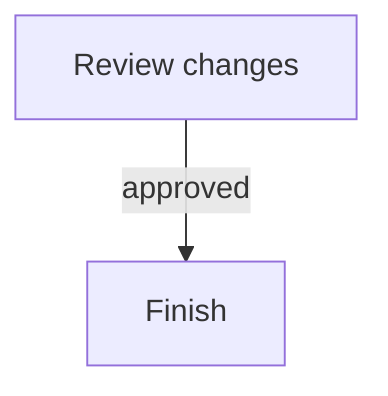

# Merstride

Merstride is a small native CLI that executes workflows embedded in Markdown.
Mermaid defines control flow; YAML defines process commands, agent tasks and
terminal results. Use it for repeatable checks, repair loops and reviews while
keeping the workflow readable alongside your project documentation.

Execution is sequential and deterministic. Merstride runs process nodes until it
reaches an agent task, a terminal node or an error, then saves progress locally.
Your existing coding agent receives an explicit request with a literal prompt,
selected context and allowed outcomes. It performs the task with its own tools
and returns an outcome. Merstride has no built-in LLM integration, API key or
model session; you or your agent explicitly call `advance` to continue.

Commands print readable English text by default, including redirected output.
For example, `merstride creation-guide` prints a copyable authoring guide directly.
Agents and scripts must pass `--json` explicitly for the unchanged protocol-1
response; existing callers that relied on default JSON must add that flag.
During `advance`, live activity on stderr identifies the run and active node,
then shows saved outcomes/routes and agent or terminal transitions. Final summaries
stay on stdout. This also works when output is redirected; `--json` suppresses activity.

## Quick start

A small workflow asks your existing agent to review changes, then finishes when
it returns `approved`. Save both blocks together as `workflow.md`:



```yaml merstride
schemaVersion: 1
id: quick_start
entry: review
nodes:
  review:
    kind: agent
    prompt: Review the current changes and return approved when ready.
  done:
    kind: end
    result: success
```

For binary downloads and platform requirements, see
[download and run](docs/RELEASING.md#download-and-run). Releases use SemVer tags
and GitHub Actions. Windows x64 and Linux x64 have local verification. The macOS
15+ Apple Silicon build, native acceptance, packaging and extracted-archive tests
without system .NET passed on GitHub-hosted runners; see [current evidence](docs/STATUS.md).
Overall release qualification and publication remain incomplete.

Build from source using the [development prerequisites and build instructions](CONTRIBUTING.md#build-and-verify)
and `pwsh -NoProfile -File scripts/build.ps1` (from native PowerShell on Windows).
The examples below use Bash
from the repository root (Git Bash on Windows). They show readable output.
On Linux/macOS, use the matching native build; Windows Bash also finds the
`.exe` on PATH. Release qualification is still incomplete;
see [current status](docs/STATUS.md) before considering distribution.

With `merstride` available, run the saved example:

```bash
set -euo pipefail
merstride --help
merstride validate workflow.md
merstride start workflow.md
merstride status workflow.md
merstride advance workflow.md
```

`start` always creates a new ready run, executes nothing, and selects it for
later commands. Earlier runs, including runs from other files, are retained.
`status` inspects the selected run; `advance` reaches the agent task above.
Omit the file on later commands to use the current run selected by start/use.
Project subdirectories share this selection. To continue a different workflow,
use `merstride advance other-workflow.md`; it selects that file's remembered
run without changing the project selection. To switch deliberately, inspect
`merstride runs` and call `merstride use <run-id>`.

`status workflow.md`, `advance workflow.md` and the other run commands accept
the same positional file spelling as start. Add `--workflow <id>` for a file with
multiple workflows and quote paths containing spaces. Bare `r_…` tokens select
run IDs; for a filename that looks like an ID, use `./r_…` or `--file <path>`.
Selection uses the frozen run even when the original file has changed or vanished.

The output shows `Status: waiting_agent`, followed by `Request`, `Prompt`,
`Allowed outcomes` and `Context`. Read them and perform the requested review.
Once the review is complete
and `approved` is the appropriate allowed outcome, return it directly:

```bash
read -r -p 'Paste the Request ID (q_ plus 6 hex digits): ' request
merstride complete workflow.md --request "$request" --outcome approved
merstride advance workflow.md
```

Optional result data goes in one JSON argument, for example
`--data '{"summary":"Review completed"}'`; omitted data defaults to `{}`. Complete
saves a receipt and moves the cursor; the subsequent `advance` executes it.
This example finishes with `Status: completed`. No output capture, JSON utility,
completion file, workspace variable or repeated state argument is needed.
New run/request IDs have eight characters, including `r_` or `q_`. Completion
finds the supplied request across this state root even if the current run has
changed. Historical retries return their original receipt, preserving newer
requests. Keep the same request ID when retrying. Automation can still retain
the exact run ID and pass it explicitly.

Storage is `.merstride/runs` at the nearest ancestor containing `.merstride` or
`.git`, otherwise in the current directory. The default workspace is that same
project boundary. Subdirectory calls find the same runs; nested Git projects are
independent. Relative workflow paths still use your current directory. First
start outside any project establishes a boundary there. Start adds a `/runs/`
rule to `.merstride/.gitignore` while preserving existing files. Runs are durable:
there is no automatic deletion or relocation. No configuration file is required.
Every run summary displays the resolved `State root`.

To remove an obsolete run, inspect its workflow and status, then discard that
specific ID. This removes its state, logs and completion receipts. It preserves
other runs and refuses locked, corrupt, linked or unexpected contents.

```bash
merstride runs
read -r -p 'Run ID to remove permanently: ' obsolete_run
merstride discard "$obsolete_run"
```

Discarding the selected run clears its selection; start or use another run
explicitly. IDs are reserved permanently within the state root and never reused
after discard. Inspect external effects before discarding interrupted work.

Before, ordinary calls required arguments like
`merstride start workflow.md --workspace "$workspace" --state-dir "$state_root"`
and `merstride advance "$run_id" --state-dir "$state_root"`. Now the basic path is
`merstride start workflow.md`, then `merstride advance`. Existing full-ID
callers remain supported. Absolute `--workspace` and `--state-dir` override only
workspace and storage respectively; reuse an explicitly selected storage root.
See [selection and project rules](docs/CLI.md#project-storage-and-selection) for
existing cwd-relative roots, missing/corrupt storage and ambiguous selections.

Repeated inspection while waiting returns the same request. If a completion
response is lost, retry the same request ID with equivalent data. Inspect every
exit code and returned status in an integration; the setup enables Bash fail-fast
handling for this success path. See the [agent operating loop](docs/AGENT-GUIDE.md)
for handling failures and other statuses explicitly. For automatic ID extraction
and structured responses, see its [JSON integration example](docs/AGENT-GUIDE.md#bash-example).

Try the [inline scripts](examples/inline-scripts.md) for shared scripts and platform
variants, or the [process chain](examples/process-chain.md) for literal command arguments
and separate stdout/stderr logs, or the [review loop](examples/review.md) for
process/agent routing. Workflows execute with your privileges in the selected
workspace; review their commands before running them.

For example, advancing the process chain shows these messages as work proceeds
(your run ID may differ):

```text
[r_000001] Process status (visit 1): activating (launch pending).
[r_000001] Process status (visit 1): saved exit code 0 (exit_0).
[r_000001] Flow #1: status -> diff via exact outcome exit_0.
[r_000001] Process diff (visit 1): activating (launch pending).
[r_000001] Process diff (visit 1): saved exit code 0 (exit_0).
[r_000001] Flow #2: diff -> done via exact outcome exit_0.
[r_000001] Run ready -> completed at done: success end; overall result: success.
```

For the agent task, `advance` instead reports `waiting for agent; request q_...`
and asks you to read the prompt and use `complete`. The stdout summary contains
that prompt, context and allowed outcomes. A saved completion reports
the agent's request/outcome, then the numbered flow movement and next explicit
advance. Process exit codes and the overall `Result` are separate. Loops show
visit numbers and revisited destinations; no-route/interruption output says the
flow stays at its cursor. See [flow output](docs/FLOW-OUTPUT.md) for before/after
branch, agent-loop and failure/recovery transcripts.
Repeating the same completion returns its receipt without new activity.
Activation is saved before launch, so its message does not claim launch succeeded.
Process output stays in separate raw logs; use `logs` to read a selected tail.

## Using Merstride

| Task | Reference |
| --- | --- |
| Write and validate workflows | `merstride creation-guide`, [authoring guide](docs/AUTHORING.md) and [examples](examples/) |
| Discover commands and exit codes | `merstride --help`, `merstride <command> --help`, [CLI usage](docs/CLI.md) |
| Integrate an existing agent or resume a run | `merstride guide`, [agent guide](docs/AGENT-GUIDE.md) |
| Handle interrupted execution | [Recovery example](examples/recovery.md) |
| Check exact behavior and limits | [Execution contract](docs/CONTRACT.md), [product scope](docs/SPEC.md) |
| Assess readiness and outstanding work | [Current status](docs/STATUS.md) |

## Developing Merstride

Start with [Contributing](CONTRIBUTING.md) for prerequisites, verification and the
approved-ticket workflow. [Architecture](docs/ARCHITECTURE.md),
[decisions](docs/adr/) and the [Gherkin acceptance features](features/) describe
the development boundaries. Project-owned code and documentation use the
[MIT license](LICENSE); shipped components retain their [third-party notices](THIRD-PARTY-NOTICES.md).
