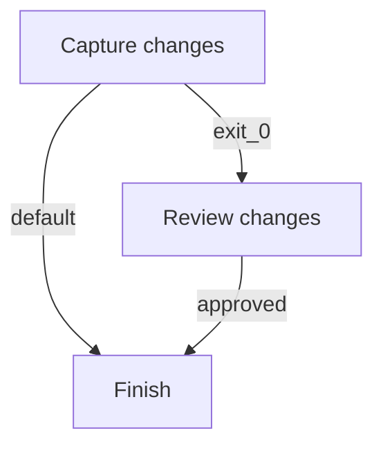

# Execution contract

Revision 0.5 — draft schema version 1 and CLI protocol version 1.

## 1. Markdown and YAML

A UTF-8 Markdown document can contain prose and ordinary diagrams. An executable workflow consists of one fenced block with info string `yaml merstride` and one `mermaid` block containing the comment `%% merstride: <id>`. The metadata `id` and marker MUST match. Block order is irrelevant. Multiple pairs are allowed; `--workflow <id>` selects one. Without selection exactly one pair MUST exist. Missing, duplicate, or conflicting pairs are errors. Ordinary unmarked Mermaid and ordinary YAML blocks are ignored.

Executable fences start at column 1, use at least three backticks, and close with at least as many backticks. The scanner MUST respect enclosing fences, so examples inside longer fences are not executable blocks. Tilde, indented, and container fences are not supported executable containers. No full CommonMark renderer is required.

Metadata shape:

```yaml merstride
schemaVersion: 1
id: example
entry: check
limits:
  maxTransitions: 20
nodes:
  check:
    kind: process
    command: git
    args: [status, --porcelain]
    timeoutSeconds: 60
  review:
    kind: agent
    prompt: |
      Review the changes and return an allowed outcome.
    context: [nodes.check.stdoutTail]
  done:
    kind: end
    result: success
```

This is a schema illustration, not a complete workflow. See `examples/review.md` for a complete pair.

Required root fields: `schemaVersion`, `id`, `entry`, `nodes`. IDs are case-sensitive and match `[a-z][a-z0-9_]{0,63}`. Unknown fields, duplicate keys, and wrong types are errors, including nested mappings. Only fields documented for each node kind are allowed. `limits.maxTransitions` is optional, defaults to 100, and accepts integers 1..10000.

Use a constrained YAML 1.2 core profile: a single mapping document; string mapping keys; scalar strings, booleans, null, finite numbers, sequences, mappings, and block strings. Reject anchors, aliases, merge keys, explicit/custom tags, and multiple documents. No object construction, file includes, environment expansion, or executable expressions. Required strings MUST be strings; numeric or boolean arguments MUST be quoted. Dates remain strings. Null is invalid for required fields. Reject malformed UTF-8. JSON input/result files reject duplicate properties and non-finite numbers as well. Validation never launches or downloads anything.

## 2. Mermaid subset

Only these forms are supported:



- Header `flowchart TD` or `flowchart LR`; comments/blank lines may precede it.
- Explicit node `id["Label"]`, one declaration per line. Labels cannot contain a physical newline, backslash, double quote, or HTML. Mermaid entities such as `#quot;` are allowed. Labels never execute.
- Edge `source --> target` or `source -->|outcome| target`, one per line. Outcomes use the ID pattern. Outside labels, indentation/whitespace is insignificant.
- Whole comment lines begin with `%%` after optional whitespace. Only the workflow marker has meaning.
- Exactly one metadata definition for each graph node, and vice versa. Entry exists. No edges or next-node fields in YAML.
- Reject implicit nodes, chains, other shapes/arrows, subgraphs, styles, click directives, diagram frontmatter, and unsupported statements. Do not silently ignore them.
- All nodes are reachable from entry, and every node has a graph path to an end node. Cycles remain possible and need runtime limits.

The supported subset MUST render as an ordinary Mermaid flowchart. A development-only renderer check is allowed; no renderer ships in the executable.

## 3. Routing and limits

An end node has no outgoing edges. A process node has either one unlabeled edge or distinct labeled edges. Mixed forms, duplicate labels, and multiple unlabeled edges fail validation. An agent node has only labeled edges, with no `default` label. Labels on its outgoing edges are its complete allowed-outcome set.

Normal process completion produces `exit_<n>` for a nonnegative exit code. Launch failure produces `spawn_error`; timeout produces `timeout`; excessive output produces `output_limit`; negative signal-style results normalize to `signal` with details retained. Exact label beats `default`. No match fails with `NO_MATCHING_EDGE`. An unlabeled process edge accepts every result and produces a validation warning about ignoring failures.

Multiple incoming edges mean alternative arrivals, never a join. Exactly one cursor is active. A successful cursor change consumes one transition. Before activating a nonterminal node with an exhausted budget, fail with `TRANSITION_LIMIT`. An end node reached on the last allowed transition may finish. Agent work outside the engine is not limited by this counter.

## 4. Process nodes

Required fields: `kind: process`, nonempty `command`, `args` (array of strings, possibly empty), integer `timeoutSeconds` from 1 to 3600. No other process fields in version 1.

Resolve bare program names through PATH and relative program paths against the absolute workspace selected at start. Child cwd is that workspace. Inherit the parent environment unchanged and close stdin. Pass each argument using the OS process API without shell interpretation, globbing, interpolation, or manual quoting. Never insert workflow output into arguments or environment variables.

PowerShell is explicit: `command: pwsh` and `args: [-NoProfile, -NonInteractive, -File, scripts/check.ps1]`. The engine itself does not require PowerShell or another shell.

Drain stdout and stderr concurrently into separate raw-byte log files. Combined retained output is capped at 10 MiB per activation. Exceeding the cap triggers best-effort process-tree termination and `output_limit`. Timeout similarly triggers termination and routes `timeout`. A timeout or output-limit cause takes precedence over the exit code caused by termination; the first observed limiting cause wins. Detached processes are not guaranteed to be terminated. Test process-tree handling on each released platform.

Default responses omit full logs. Context tails contain at most 4096 UTF-8 bytes per stream, decoded with replacement for invalid byte sequences and cut at character boundaries. Include truncation flags and observed byte counts. Do not buffer unbounded output. Workspace scripts are not copied or frozen at start.

## 5. Agent nodes and completion

Required fields: `kind: agent`, nonempty `prompt` (at most 16 KiB UTF-8). Optional `context` is an array of unique selectors:

- `input`: the object supplied to start, or `{}`.
- `nodes.<id>.exitCode`, `nodes.<id>.stdoutTail`, `nodes.<id>.stderrTail` for process nodes.
- `nodes.<id>.data` for agent nodes.

Referenced nodes and selector/kind combinations MUST be valid. Each selector reads the most recently completed activation of that node. If none exists, return `available: false`. In a loop, “latest completed” can mean an earlier iteration; include the activation ID so the consumer can tell. A process result without a normal exit code exposes null for `exitCode`.

Return selector, availability, value, source activation ID where applicable, and truncation information where applicable. Keep context separate from instructions. Prompts are literal strings with no template evaluation. Prompt plus serialized context MUST fit 32 KiB UTF-8; otherwise fail with `CONTEXT_LIMIT`. Input and agent data are JSON objects, each at most 16 KiB and depth 16. The root object has depth 1; each nested object or array adds 1. No per-node custom JSON Schema in the MVP. Size checks use compact UTF-8 JSON serialization of parsed values.

Every entry into an agent node creates a fresh random request ID and `waiting_agent`. `status` and repeated `advance` return the same request without changing progress. Allowed outcomes are returned in ordinal sort order.

```json
{"protocolVersion":1,"runId":"r_01","status":"waiting_agent","request":{"id":"q_01","nodeId":"review","prompt":"Review changes.","allowedOutcomes":["approved","recheck"],"context":[]},"error":null}
```

Completion files contain required `outcome` and optional object `data` (default `{}`), with no unknown fields. `complete` validates the request, outcome, and payload; atomically stores its receipt and the next cursor; and returns `ready`. It MUST NOT execute the next node, even an end node.

Repeating an accepted completion with the same request ID and equivalent parsed payload returns the original receipt and current run status, without another transition. Object key order is irrelevant, array order matters, strings compare ordinally. Numbers compare as finite IEEE-754 binary64 values; reject integers outside ±9007199254740991. A differing payload for an accepted ID yields `COMPLETION_CONFLICT`. An unknown ID yields `INVALID_REQUEST`; an unknown outcome yields `INVALID_OUTCOME`; oversize data yields `DATA_LIMIT`. Rejected completion leaves persisted state unchanged. A historical accepted request never completes a newer request.

## 6. Terminal nodes

Required fields: `kind: end`, `result: success|failure`. No other fields. `advance` changes a success end to `completed`, or a failure end to `failed` with `WORKFLOW_FAILURE`.

## 7. CLI

Every command supports `--json`: exactly one JSON object on stdout; incidental diagnostics on stderr. No banner, ANSI, or progress text on stdout. Responses contain `protocolVersion`, optional `runId`, `status`, and `error` (null or object with stable `code`, `message`, optional `location`). Source locations use 1-based lines and columns. Pre-run responses have null status. Default errors omit stack traces. Additive response fields are allowed; incompatible changes increment protocolVersion.

| Command | Behavior |
| --- | --- |
| `validate <file> [--workflow <id>]` | Validate only; return diagnostics with severity and source locations. |
| `start <file> --workspace <absolute-path> [--workflow <id>] [--input-file <file>]` | Validate, snapshot, persist a new run, return ready; execute nothing. |
| `advance <run-id>` | Execute synchronously until waiting_agent, terminal state, or error. |
| `status <run-id>` | Read compact state, cursor, and current request. |
| `complete <run-id> --request <id> --result-file <file>` | Save completion and transition only. |
| `resolve <run-id> --retry` | Only interrupted: explicitly allow a new attempt, return ready. |
| `resolve <run-id> --fail` | Only interrupted: finish failed without actions. |
| `logs <run-id> --activation <id> --stream stdout\|stderr [--tail-bytes <n>]` | Read selected log; default/maximum 65536 bytes; n is positive. |
| `guide` | Offline compact agent usage guide, no run required; JSON has a guide string. |
| `version` | Tool and protocol version. |

P08 adds `-h` / `--help` at the root and for every command. Help exits 0 without
workflow/state access: English text by default, or one protocol object with a
`guide` string under `--json`. Root `--version` shares the `version` JSON response.
Global options work before/after the command, before `--`; the delimiter makes
remaining positionals literal. Quote paths with spaces; use `--option=value` for
dash-prefixed option values. Duplicate options (including flags/help aliases),
unknown/missing/extra/conflicting arguments return usage exit 2 and a help hint.
Response files, directives, abbreviations and option bundles are disabled.
See [CLI usage](CLI.md) for examples and exact discovery semantics.

Global `--state-dir <absolute-path>` selects storage. Default is `.merstride/runs` beneath the calling cwd. Start returns the absolute state root; later calls MUST reuse it. Opaque run IDs cannot be used as arbitrary filesystem paths. No delete/publish command in the MVP.

CLI exit codes: 0 successful operation (including ready/waiting/completed); 2 usage; 3 document validation; 4 state/lock/completion conflict; 5 advance ending failed/interrupted or resolve --fail; 6 I/O/corrupt storage/internal error; 130 user interruption. Read-only status succeeds with 0 even when the run failed. Child exit codes are not CLI exit codes. Advance on terminal runs returns their existing result without executing anything; failed returns 5. Guide, version, validate, status, and logs never launch child processes.

## 8. Persistence and concurrency

States: ready, executing, waiting_agent, completed, failed, interrupted. Completed and failed are terminal. Each start creates a new run ID. Persist definition snapshot, SHA-256 source hash, tool version, workspace, input, cursor, transition count, activation summaries, latest node results, and completion receipts. Activations have IDs, timestamps, outcomes, and log paths. Do not expose the whole history in default status.

One OS-backed per-run exclusive writer lock covers each mutating operation and the entire advance chain. A concurrent writer fails immediately with `RUN_LOCKED`. Different runs remain independent. Lock-file existence is not proof of a held lock. Readers observe complete atomic snapshots; status can report executing while a live writer holds the lock.

Persist an executing activation before launching its process. On completion, close/flush logs, then atomically replace authoritative state containing result and route. Temp files and replacement are in the same directory. State and completion receipts share one authoritative file. Logs are not authoritative. No full event-sourcing system required.

After a lost writer lock, persisted executing means interrupted: the external effect may already have happened. A read-only status projects interrupted without rewriting state; a writer records it. Advance executes nothing in this condition. Resolve --retry returns ready, retains the interrupted activation, and gives the next attempt a fresh activation ID. Resolve --fail executes nothing. No automatic process replay and no exactly-once promise.

Ctrl+C attempts to terminate the process tree, persist interrupted, and exit 130. If persistence fails, executing remains for later detection. Corrupt state produces an error; never overwrite it with an empty run. Atomic-write behavior MUST be tested on supported filesystems; physical disk failure is outside guarantees.
