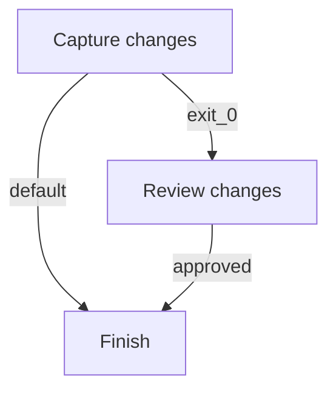

# Execution contract

Schema version 1 and CLI protocol version 1.

## 1. Markdown and YAML

A UTF-8 Markdown document can contain prose and ordinary diagrams. An executable workflow consists of one fenced block with info string `yaml merstride` and one `mermaid` block containing the comment `%% merstride: <id>`. The metadata `id` and marker MUST match. Block order is irrelevant. Multiple pairs are allowed; `--workflow <id>` selects one. Without selection exactly one pair MUST exist. Missing, duplicate, or conflicting pairs are errors. Ordinary unmarked Mermaid and ordinary YAML blocks are ignored.

Executable fences start at column 1, use at least three backticks, and close with at least as many backticks. The scanner MUST respect enclosing fences, so examples inside longer fences are not executable blocks. Tilde, indented, and container fences are not supported executable containers. No full CommonMark renderer is required.

Metadata shape:

```yaml merstride
schemaVersion: 1
id: example
entry: check
limits:
  maxTransitions: 20
nodes:
  check:
    kind: process
    command: git
    args: [status, --porcelain]
    timeoutSeconds: 60
  review:
    kind: agent
    prompt: |
      Review the changes and return an allowed outcome.
    context: [nodes.check.stdoutTail]
  done:
    kind: end
    result: success
```

This is a schema illustration, not a complete workflow. See `examples/review.md` for a complete pair.

Required root fields: `schemaVersion`, `id`, `entry`, `nodes`. IDs are case-sensitive and match `[a-z][a-z0-9_]{0,63}`. Unknown fields, duplicate keys, and wrong types are errors, including nested mappings. Only fields documented for each node kind are allowed. `limits.maxTransitions` is optional, defaults to 100, and accepts integers 1..10000.

Use a constrained YAML 1.2 core profile: a single mapping document; string mapping keys; scalar strings, booleans, null, finite numbers, sequences, mappings, and block strings. Reject anchors, aliases, merge keys, explicit/custom tags, and multiple documents. No object construction, file includes, environment expansion, or executable expressions. Required strings MUST be strings; numeric or boolean arguments MUST be quoted. Dates remain strings. Null is invalid for required fields. Reject malformed UTF-8. JSON input/result files reject duplicate properties and non-finite numbers as well. Validation never launches or downloads anything.

## 2. Mermaid subset

Only these forms are supported:



- Header `flowchart TD` or `flowchart LR`; comments/blank lines may precede it.
- Explicit node `id["Label"]`, one declaration per line. Labels cannot contain a physical newline, backslash, double quote, or HTML. Mermaid entities such as `#quot;` are allowed. Labels never execute.
- Edge `source --> target` or `source -->|outcome| target`, one per line. Outcomes use the ID pattern. Outside labels, indentation/whitespace is insignificant.
- Whole comment lines begin with `%%` after optional whitespace. Only the workflow marker has meaning.
- Exactly one metadata definition for each graph node, and vice versa. Entry exists. No edges or next-node fields in YAML.
- Reject implicit nodes, chains, other shapes/arrows, subgraphs, styles, click directives, diagram frontmatter, and unsupported statements. Do not silently ignore them.
- All nodes are reachable from entry, and every node has a graph path to an end node. Cycles remain possible and need runtime limits.

The supported subset MUST render as an ordinary Mermaid flowchart. A development-only renderer check is allowed; no renderer ships in the executable.

## 3. Routing and limits

An end node has no outgoing edges. A process node has either one unlabeled edge or distinct labeled edges. Mixed forms, duplicate labels, and multiple unlabeled edges fail validation. An agent node has only labeled edges, with no `default` label. Labels on its outgoing edges are its complete allowed-outcome set.

Normal process completion produces `exit_<n>` for a nonnegative exit code. Launch failure produces `spawn_error`; timeout produces `timeout`; excessive output produces `output_limit`; negative signal-style results normalize to `signal` with details retained. Exact label beats `default`. No match fails with `NO_MATCHING_EDGE`. An unlabeled process edge accepts every result and produces a validation warning about ignoring failures.

Multiple incoming edges mean alternative arrivals, never a join. Exactly one cursor is active. A successful cursor change consumes one transition. Before activating a nonterminal node with an exhausted budget, fail with `TRANSITION_LIMIT`. An end node reached on the last allowed transition may finish. Agent work outside the engine is not limited by this counter.

## 4. Process nodes

Required fields: `kind: process` and integer `timeoutSeconds` from 1 to 3600,
plus exactly one execution form:

- Nonempty `command` and `args` (array of strings, possibly empty).
- `script`, a multiline YAML literal block scalar (`|`, `|-` or `|+`) with a
  first-line shebang. Folded/quoted scalars and NUL characters are invalid.
- Nonempty `variants` array. Each mapping has exactly one of the two forms above
  and optional `platforms`: a string or nonempty array of unique strings from
  `windows`, `macos`, `linux` (case-sensitive). `timeoutSeconds` belongs to the node.

Forms cannot be mixed, including `args` alongside `script` or an execution beside
`variants`. A variant without `platforms` applies to **all three platforms**.
Reject overlapping variants during validate/start, including duplicate/equivalent
conditions and any unconditional/specific overlap. Absence is not fallback.
All variants are validated without launching/probing anything. Missing coverage
is valid: advance chooses only the current platform's variant; no match produces
`spawn_error`, with `NO_PLATFORM_VARIANT` in the activation's stderr log. There is
no new process outcome. Existing exact/default/unlabeled routing and CLI exit
semantics apply (including exit 5 / `NO_MATCHING_EDGE` without a matching route).

Resolve bare program names through PATH and relative program paths against the absolute workspace selected at start. Child cwd is that workspace. Inherit the parent environment unchanged and close stdin. Pass each argument using the OS process API without shell interpretation, globbing, interpolation, or manual quoting. Never insert workflow output into arguments or environment variables.

PowerShell is explicit: `command: pwsh` and `args: [-NoProfile, -NonInteractive, -File, scripts/check.ps1]`. The engine itself does not require PowerShell or another shell.

For inline execution, `#!INTERPRETER [ARG ...]` selects an installed executable,
including on Windows; native OS shebang dispatch is never needed. ASCII space/tab
separates tokens. Single/double quotes group tokens (including paths with spaces
and empty arguments); quotes are removed, backslashes are literal, and there are
no escapes, variables, globbing, substitutions or shell operators. Unclosed quotes,
empty/option/assignment interpreter tokens and control characters except tab fail
with located `INVALID_DOCUMENT` (exit 3). The shebang must end with a newline;
the subsequent body may be empty. YAML normalizes line endings to LF and applies
its usual literal-block chomping. Unicode is preserved.

`#!/usr/bin/env NAME` and `#!env NAME` resolve NAME directly; the env program is
not launched. `env -S NAME ARG ...` additionally allows interpreter arguments.
Other env options, assignments, path-valued NAMEs, and multiple tokens without
`-S` are unsupported and fail validation. No env command splitting/expansion occurs.

Bare inline interpreter names search inherited PATH in order, ignoring empty
entries; relative PATH directories resolve against the workspace. On Windows,
extensionless names try `.exe`, then `.com` in each directory; names with an
extension are exact. No PATHEXT expansion or implicit current-directory search.
Explicit absolute paths and paths containing `/` or `\` bypass PATH; relative
paths resolve against the saved workspace. Paths are native to the current OS.
A missing bare interpreter produces `spawn_error` with `INTERPRETER_UNAVAILABLE`
in stderr; a path/interpreter that cannot launch produces `spawn_error` with
`PROCESS_UNAVAILABLE`. Validation never checks installation or executes a probe.

Pass shebang arguments literally through the OS API. Deliver the body (without
the shebang) as UTF-8 without BOM through redirected stdin, then close it. Do not
write a script file, insert invocation flags, replace an interpreter, download or
bundle one. Authors must choose an interpreter/flags that execute UTF-8 stdin:
for example `#!bash --noprofile --norc`, `#!python3 -X utf8 -`, or
`#!pwsh -NoLogo -NoProfile -NonInteractive -Command -`. Interpreters that require
script files or different invocation modes are unsuitable; their own syntax/flag
errors retain normal exit routing. There is no separate stdin for interactive or
workflow data; direct commands retain closed stdin. The feeder is bounded by the
1 MiB document limit, runs concurrently with log draining, and is canceled under
the same timeout/output/interruption controls. Early interpreter exit closes input
without hiding its exit result, including pipe write/close errors after the reader
has exited. On Unix, PowerShell's `-Command -` can emit terminal control bytes even
with redirected output and `-NonInteractive`. Callers requiring plain PowerShell
output can set `TERM=dumb` when invoking advance; the engine does not change that
environment variable or remove bytes from raw logs. Freeze script body, shebang
arguments and every variant in the run definition; workspace script files remain live.

Drain stdout and stderr concurrently into separate raw-byte log files. Combined retained output is capped at 10 MiB per activation. Exceeding the cap triggers best-effort process-tree termination and `output_limit`. Timeout similarly triggers termination and routes `timeout`. A timeout or output-limit cause takes precedence over the exit code caused by termination; the first observed limiting cause wins. Detached processes are not guaranteed to be terminated. Test process-tree handling on each released platform.

Default responses omit full logs. Context tails contain at most 4096 UTF-8 bytes per stream, decoded with replacement for invalid byte sequences and cut at character boundaries. Include truncation flags and observed byte counts. Do not buffer unbounded output. Workspace scripts are not copied or frozen at start.

## 5. Agent nodes and completion

Required fields: `kind: agent`, nonempty `prompt` (at most 16 KiB UTF-8). Optional `context` is an array of unique selectors:

- `input`: the object supplied to start, or `{}`.
- `nodes.<id>.exitCode`, `nodes.<id>.stdoutTail`, `nodes.<id>.stderrTail` for process nodes.
- `nodes.<id>.data` for agent nodes.

Referenced nodes and selector/kind combinations MUST be valid. Each selector reads the most recently completed activation of that node. If none exists, return `available: false`. In a loop, “latest completed” can mean an earlier iteration; include the activation ID so the consumer can tell. A process result without a normal exit code exposes null for `exitCode`.

Return selector, availability, value, source activation ID where applicable, and truncation information where applicable. Keep context separate from instructions. Prompts are literal strings with no template evaluation. Prompt plus serialized context MUST fit 32 KiB UTF-8; otherwise fail with `CONTEXT_LIMIT`. Input and agent data are JSON objects, each at most 16 KiB and depth 16. The root object has depth 1; each nested object or array adds 1. No per-node custom JSON Schema in the MVP. Size checks use compact UTF-8 JSON serialization of parsed values.

Every entry into an agent node creates a fresh reserved request ID and `waiting_agent`. `status` and repeated `advance` return the same request without changing progress. Allowed outcomes are returned in ordinal sort order.

```json
{"protocolVersion":1,"runId":"r_000001","status":"waiting_agent","request":{"id":"q_000002","nodeId":"review","prompt":"Review changes.","allowedOutcomes":["approved","recheck"],"context":[]},"error":null}
```

`complete <run-id> --request <id> --outcome <outcome>` is the preferred
completion input. Optional `--data <json-object>` defaults to `{}` and has the same
object, size, depth, duplicate-key and numeric rules as file data. For compatibility,
`--result-file <file>` remains an alternative: completion files contain required
`outcome` and optional object `data` (default `{}`), with no unknown fields. Exactly
one input mode is required; `--data` requires `--outcome`. Invalid mode/argument
syntax returns USAGE (exit 2); invalid JSON/data returns INVALID_PAYLOAD, or DATA_LIMIT
for oversized data (exit 4), without mutation. Input mode does not affect receipt
identity or equivalence. `complete` validates the request, outcome, and payload;
atomically stores its receipt and the next cursor; and returns `ready`. It MUST NOT
execute the next node, even an end node.

Repeating an accepted completion with the same request ID and equivalent parsed payload returns the original receipt and current run status, without another transition. Object key order is irrelevant, array order matters, strings compare ordinally. Numbers compare as finite IEEE-754 binary64 values; reject integers outside ±9007199254740991. A differing payload for an accepted ID yields `COMPLETION_CONFLICT`. An unknown ID yields `INVALID_REQUEST`; an unknown outcome yields `INVALID_OUTCOME`; oversize data yields `DATA_LIMIT`. Rejected completion leaves persisted state unchanged. A historical accepted request never completes a newer request.

## 6. Terminal nodes

Required fields: `kind: end`, `result: success|failure`. No other fields. `advance` changes a success end to `completed`, or a failure end to `failed` with `WORKFLOW_FAILURE`.

## 7. CLI

Without `--json`, every command returns readable English text, including redirected
stdout. This is an intentional default-output change: existing scripts must add
`--json` explicitly. Terminal detection never selects a different format. Results,
help, guides, run summaries and selected log text go to stdout. Errors and validation
diagnostics (including warnings) go to stderr, with severity, stable code, message
and 1-based line/column when available. A failed run's read-only status still exits
0: its summary goes to stdout and its failure reason to stderr. Usage errors retain
a help hint. Stack traces are hidden. No colors or ANSI formatting.

Text advance (including `start --advance`) emits live, newline-delimited activity on stderr, also when redirected.
Each line starts with `[<run-id>]`. Process lines identify the node and visit number
and explain activation (launch still pending) or the saved process outcome in English
alongside its routing token. Separate `Flow #<transition-count>: <source> -> <destination>`
lines explain exact outcome, default fallback or unlabeled routing. Revisited targets
show the next visit number, including self-loops. Node IDs are the authoritative
names; diagram labels are not displayed or newly persisted. Run-status lines separately
explain waiting, terminal success/failure or interruption and its next action. An
exit code or routed outcome is not an overall run result. No-route results explicitly
say the flow stays at the cursor; interruption never invents a route.

Only report saved activity after a successful authoritative write. Activation does
not claim that launch succeeded. A failed save emits no saved-result, route or
terminal-success message. Completion reports its saved request/outcome and numbered
cursor movement separately, with a reminder that the next node has not executed; equivalent
retries return the receipt without announcing new acceptance. Inspection, repeated
waiting/terminal advance, and start do not replay activity. Waiting and interrupted
summaries explain the next explicit caller action even on inspection. Successful
explicit resolution announces `interrupted -> ready|failed` with an unchanged cursor
and no execution. Retry warns that effects may repeat and requires a later advance.

Activity uses the same escaping as text summaries, contains no prompts or child
output, and has no periodic polling noise, colors or full history. There are at
most three lines per process-result write (result, movement or staying, optional run
failure/interruption), one per activation/waiting/end/resolution write and two per
accepted completion, bounded by the existing transition limit. Final summaries remain on stdout.
Redirect stdout and stderr separately to separate results from activity/errors;
ordering is guaranteed within the activity stream, not across two redirected
streams. Closed activity pipes disable further activity without changing execution.
There is no persisted event format, log subsystem, automatic advance or retry.
Explicit --json suppresses all activity on both streams.

Text run summaries include run ID, state root, status, cursor, transition count
and a distinct overall result (`not finished`, `success`, `failure`, or `unresolved`).
Status tokens have English explanations; next actions distinguish advance, completion,
terminal runs and explicit recovery. The latest process or agent outcome is separate
from the overall result. Full process activation IDs appear only as secondary log
selectors in summaries, not on each activity line. Source and state root remain
available after the main result. Waiting-agent results additionally
show request ID, node, literal prompt, allowed outcomes and selected context with
availability, source activation and truncation/observed-byte information. Completion
includes the saved request/outcome receipt summary and makes retry semantics explicit. Do not expand
full activation history or full logs in ordinary status. Unavailable context and
available empty/null values remain distinct.

Text preserves Unicode, LF newlines and tabs; CRLF becomes LF. Other control and
Unicode format characters (including ESC and lone CR) become visible `\uXXXX`
escapes, so embedded terminal controls cannot execute. This applies to prompts,
context, diagnostics, paths and logs, without changing stored raw data. `logs`
includes run, activation, stream and a tail-truncation flag, followed by the selected
decoded content, with the same 65536-byte maximum input tail as JSON. Escaping can
expand each UTF-16 code unit to at most six visible characters. These presentation
rules never change effects, exit codes, state transitions, persistence or limits.

Every command supports `--json`: exactly one JSON object on stdout; incidental diagnostics on stderr. No banner, ANSI, or progress text on stdout. Responses contain `protocolVersion`, optional `runId`, `status`, and `error` (null or object with stable `code`, `message`, optional `location`). Source locations use 1-based lines and columns. Pre-run responses have null status. Default errors omit stack traces. Additive response fields are allowed; incompatible changes increment protocolVersion.
Explicit JSON retains the existing version-1 response fields, values and escaping;
errors/validation diagnostics are inside that object, without duplicate text on
stderr. The presentation-default change does not increment protocolVersion.
An explicit `--json` or malformed `--json=...` before `--` also selects JSON for
argument errors, including duplicate options. A `--json` token after the delimiter
is literal and does not select output format.

| Command | Behavior |
| --- | --- |
| `validate <file> [--workflow <id>]` | Validate only; return diagnostics with severity and source locations. |
| `start <file> [--workspace <absolute-path>] [--workflow <id>] [--input-file <file>] [--advance]` | Validate, snapshot, persist/select a distinct ready run. Ordinary start executes nothing. Explicit --advance performs its first synchronous advance in this invocation. Workspace defaults to the project boundary below. |
| `advance [run-id|file] [--file <path> [--workflow <id>]]` | Execute synchronously until waiting_agent, terminal state, or error. |
| `status [run-id|file] [--file <path> [--workflow <id>]]` | Read compact state, cursor, and current request. |
| `complete [run-id|file] --request <id> --outcome <outcome> [--data <json-object>]` | Preferred file-free completion; save receipt and transition only. Alternative: `--result-file <file>`. |
| `resolve [run-id|file] --retry` | Only interrupted: explicitly allow a new attempt, return ready. |
| `resolve [run-id|file] --fail` | Only interrupted: finish failed without actions. |
| `logs [run-id|file] --activation <id> --stream stdout\|stderr [--tail-bytes <n>]` | Read selected log; default/maximum 65536 bytes; n is positive. |
| `runs [file] [--workflow <id>]` | List retained runs with source, workflow, status and current/discarding markers; unreadable entries stay visible. |
| `use <run-id>` | Deliberately select this run as current and for its source/workflow association. |
| `discard <run-id>` | Permanently remove only this explicitly selected run, its logs and receipts. No implicit selector or bulk deletion. |
| `guide` | Offline compact agent usage guide, no run required; JSON has a guide string. |
| `creation-guide` | Offline self-contained workflow authoring instructions and a complete copyable example; embedded in the native binary. No arguments or workflow/state access; JSON has a guide string. |
| `version` | Tool and protocol version. |

`-h` / `--help` is available at the root and for every command. Help exits 0 without
workflow/state access: English text by default, or one protocol object with a
`guide` string under `--json`. Root `--version` shares the `version` JSON response.
Global options work before/after the command, before `--`; the delimiter makes
remaining positionals literal. Quote paths with spaces; use `--option=value` for
dash-prefixed option values. Duplicate options (including flags/help aliases),
unknown/missing/extra/conflicting arguments return usage exit 2 and a help hint.
Response files, directives, abbreviations and option bundles are disabled.
See [CLI usage](CLI.md) for examples and exact discovery semantics.

### Optional initial execution

`start <file> --advance` creates and selects a new run using ordinary start's
workflow selection, workspace, input, state-root preparation and snapshots, then
performs exactly one ordinary synchronous advance. It can traverse multiple nodes
until waiting_agent, terminal state or error. Plain start remains nonexecuting.
Completion still never executes the next node. This replaces two native CLI calls
with one; no measured token saving is established.

Release the root context lock after creation/selection, before taking the new
run's writer lock for the whole advance. Pass the created exact identity directly;
never rediscover current/latest or a source association between phases. Reread
that exact run under its lock. Other starts/use may change context without
retargeting this advance; normal writer exclusion still applies.

Argument, workflow/input, preparation and initial persistence failures execute no
node. After successful creation, retain its identity and all saved progress on
selection/advance failure. Never erase the run, roll back external effects,
automatically retry or replay. A failed selection save leaves ready and performs
no advance. Inspect the exact run in the original root, then use/advance/resolve
explicitly as appropriate; repeating start creates a different run.

Handle supported user interrupts from the beginning of combined preparation.
Cancellation observed before entering creation saves no run and exits 130.
Once creation starts, finish its durable creation/selection attempt, then check
cancellation before acquiring the advance lock: if canceled, keep ready, return
INTERRUPTED/130 and report that initial advance did not start. The caller may
advance this exact ready run explicitly; resolve is unnecessary. This boundary
ends at that cancellation check. A later signal follows ordinary advance's
interrupted/explicit-resolution semantics, including before its first activation.
Failure during cancellation retains identity and exit 130; a failed recovery save
reports that it could not be saved. Forced termination may produce no response;
use runs/status and inspect effects. There is no cross-phase atomic transaction.

Combined JSON is one protocol-1 response with the normal run/request/status/error
fields plus additive `start: {created, phase, advance}`. `created` means the initial
ready snapshot was durably saved. `phase` is `creation`, `selection` or `advance`;
`advance` is `not_started`, `finished`, `interrupted` or `error`. `finished` means
the engine returned normally, including a failed workflow (exit 5); it never means
overall success. `error` means initial advance stopped on an operational exception;
a refusal before entering the engine is `not_started`. After a post-creation
exception, return a fresh status projection if readable, otherwise null status
with the created identity/root and error. Never substitute an unsaved result.
Cancellation whose recovery save failed may project interrupted as ordinary
advance does; its error explicitly says the recovery save failed.

`start` metadata is null on other responses, including ordinary start and errors
before the combined handler (argument parsing/project discovery). Protocol version
stays 1; consumers with strict response allowlists must accept this additive field.
No saved-state schema migration is needed. JSON suppresses all human activity.
Text adds one saved-creation activity line before advance, then the usual bounded
activity; stdout distinguishes creation, phase, initial-advance outcome and final
run status/next action. Creation never claims selection or execution succeeded.
See [ADR 0017](adr/0017-p21.md).

`creation-guide` follows `guide` output conventions: directly readable instructions
with real line breaks and a copyable example by default; with `--json`, one
protocol-version-1 object with a nonempty `guide`, null status/error and exit 0.
Both guides need no workspace, workflow, run or external content file; even an
unusable state path is ignored. Retrieval creates/mutates no state, launches no
child process, makes no network request and never executes its example.

Global `--state-dir <absolute-path>` overrides storage. Without it, walk upward
from cwd to the nearest directory containing a `.merstride` or `.git` entry
(directory or file); stop there, including nested Git projects. Without a marker,
use cwd. This boundary supplies the default workspace and `.merstride/runs` state
root. Explicit absolute `--workspace` changes only the workspace; explicit absolute
`--state-dir` changes only storage. There are no configuration/environment sources.
Relative workflow paths remain relative to the caller. Start and run summaries
report the resolved absolute state root. Help/version/guides ignore storage.

Existing cwd-relative `.merstride` directories remain boundaries and are found
from their subdirectories. Outside a project, first start establishes a cwd
boundary. A markerless child before first use is independent. Never relocate,
merge, overwrite or silently delete existing state. Explicit discard is defined
below. Start appends `/runs/` if absent to
`.merstride/.gitignore`, retaining existing bytes and parent ignore/config files;
only start creates it. Explicit roots receive no automatic ignore changes.
A failed preparation may leave an empty directory/ignore rule. Mutable run state
is durable, regardless of directory naming. A `.merstride` file is an actionable
I/O conflict, never permission to fall back to a parent or different root.

Start always creates a distinct ready run, retains earlier runs and selects the
new run both as this state root's current run and for its source-file/workflow
association. The association is the lexically normalized absolute source path
(native case comparison) plus selected workflow ID. Different files remain
distinct even with identical content/IDs. Symlink aliases are distinct. Content
changes do not change the association or frozen definition; renames create new
associations. Continuing never requires rereading an existing source file.

For status/advance/complete/resolve/logs, select an optional positional run ID or
workflow source path; --file <path> is an alternative to the positional selector.
Add --workflow <id> for a source path, never an explicit run ID. Exactly one
positional selector OR --file is allowed. Without either use the remembered
current run, including terminal runs. The file selector uses that association's
remembered run; multiple workflows at a path require --workflow. Relative selector
paths use the caller's cwd. Only roots with no context file retain exactly-one-run
fallback, including corrupt/incomplete/terminal directories. Multiple matches
return AMBIGUOUS_RUN (4); no match RUN_NOT_FOUND (4). Stale/cleared context returns
STALE_CONTEXT (4), never a survivor/newest-run fallback; corrupt context returns
CORRUPT_CONTEXT (6). Explicit run selectors bypass context. `use` deliberately
switches both selections; ordinary explicit commands do not switch them.

Bare positional tokens beginning r_ (without a path separator) are reserved for
run IDs; malformed such IDs return INVALID_RUN_ID (4). All other tokens are
workflow source paths, including extensionless names. No existence probe decides
the interpretation. Quote paths with spaces; absolute/relative paths use native
rules. Use ./r_000001 or --file r_000001 for an ID-shaped filename. The -- delimiter
makes remaining tokens literal paths/IDs; output flags after it are literal too.
Invalid path syntax returns USAGE (2); a missing source association STALE_CONTEXT
(4). This deliberately reinterprets formerly invalid non-r_ run tokens as source
paths. runs [file] filters inventory; use/discard always require explicit run IDs.

Context is shared within the resolved state root, including subdirectories and
explicit-root callers. Start/use/discard serialize under an OS context lock;
competing changes fail with CONTEXT_LOCKED (4). Selection is resolved once per
invocation before taking the per-run writer lock. Subsequent changes cannot
retarget that operation. Context writes are atomic; a failed start context write
can leave its new ready run for explicit recovery through runs/use. There is no
global newest-state heuristic. Concurrent workflows can use --file or exact IDs.

New canonical run/request IDs are eight characters: r_/q_ plus six lowercase hex
digits. They are predictable opaque identities, not secrets. A durable allocator
reserves each ID under an exclusive identity lock before use. Competing allocations
fail IDENTITY_LOCKED (4); collisions skip occupied reservations/live directories
without overwriting anything. Reservations survive discard and crashes may burn
IDs. After 0xffffff allocations IDs lengthen, up to sixteen hex digits; exhaustion
fails without reuse. Activation IDs remain full random IDs for logs/history.

Existing 34-character run/request IDs and state snapshots remain supported. Run
and request selectors accept six through 32 lowercase hex digits after their type
prefix. Exact stored IDs take precedence over prefix matches, including matching
longer IDs. A prefix with multiple matches returns AMBIGUOUS_RUN/AMBIGUOUS_REQUEST
(4); invalid run syntax returns INVALID_RUN_ID (4). Missing full-ID direct targets
retain exit-6 I/O errors. Prefix convenience is not a stable automation identity:
retain exact IDs. JSON remains protocol 1 with opaque canonical IDs and additive
sourcePath/inventory/discard fields. Clients must not require UUID-length IDs.
Legacy snapshots have no source association and work through explicit IDs/use.
Older binaries do not understand the new short-ID directories/additive state
fields; use this version for roots adopting P19. No automatic relocation/rewrite.

--request is always required; context-only completion is forbidden. Without a
run/file selector, complete finds that exact request across current requests and
historical receipts in this root, independent of current-run changes. Exact
identities win over prefix matches across runs too. Multiple matching runs return
AMBIGUOUS_REQUEST (4); missing/invalid requests return INVALID_REQUEST (4).
Unreadable snapshots fail the search closed; an explicit run/file selector bounds
it. Under the selected writer lock, request resolution is repeated against current
requests AND historical receipts. Historical retries return their original receipt
or COMPLETION_CONFLICT and cannot complete a newer loop request. No selector
can become an arbitrary filesystem path.

Start never deletes earlier state. `runs` lists retained workflows/statuses,
including unreadable and staged-discard entries. `discard <run-id>` deliberately
removes one selected run, including logs and receipts, regardless of terminal
status. A held writer lock returns RUN_LOCKED (4). Corrupt/unreadable snapshots,
unknown files/directories, or symlinks/reparse points in the deletion path are
refused (6); directory naming alone never authorizes deletion. Discard never kills
processes or reverses external effects; inspect interrupted effects first.

Discard validates owned contents under context/run locks, saves a durable discard
marker, then releases the run lock. New run writers check the marker under their
lock and fail DISCARD_PENDING (4). This permits Windows directory moves without
open child handles. Move into this root's .trash atomically, clear only this run's
context references, and remove validated files without following links; delete
authoritative state last. Retain a minimal run/source/workflow ownership record
until the empty stage directory is removed, allowing same-ID retries after the
snapshot or directory has already gone. It contains no logs or receipts.
Other workflows, identity reservations and arbitrary
contents remain untouched. Failure returns DISCARD_INCOMPLETE/IO_ERROR (6), never
success; staged runs are visible in runs and retryable by the same explicit ID.
A cleared selection requires start/use, never automatic selection of a survivor.
See [ADR 0015](adr/0015-p19.md) for compatibility and failure ordering.

CLI exit codes: 0 successful operation (including ready/waiting/completed); 2 usage; 3 document validation; 4 state/lock/completion conflict; 5 advance ending failed/interrupted or resolve --fail; 6 I/O/corrupt storage/internal error; 130 user interruption. Read-only status succeeds with 0 even when the run failed. Child exit codes are not CLI exit codes. Advance on terminal runs returns their existing result without executing anything; failed returns 5. Guide, creation-guide, version, validate, status, and logs never launch child processes.

## 8. Persistence and concurrency

States: ready, executing, waiting_agent, completed, failed, interrupted. Completed and failed are terminal. Each start creates a new run ID. Persist definition snapshot, absolute source path, SHA-256 source hash, tool version, workspace, input, cursor, transition count, activation summaries, latest node results, and completion receipts. Activations have IDs, timestamps, outcomes, and log paths. Do not expose the whole history in default status.

One OS-backed per-run exclusive writer lock covers each mutating operation and the entire advance chain. A concurrent writer fails immediately with `RUN_LOCKED`. Different runs remain independent. Lock-file existence is not proof of a held lock. Readers observe complete atomic snapshots; status can report executing while a live writer holds the lock.

Persist an executing activation before launching its process. On completion, close/flush logs, then atomically replace authoritative state containing result and route. Temp files and replacement are in the same directory. State and completion receipts share one authoritative file. Logs are not authoritative. No full event-sourcing system required.

After a lost writer lock, persisted executing means interrupted: the external effect may already have happened. A read-only status projects interrupted without rewriting state; a writer records it. Advance executes nothing in this condition. Resolve --retry returns ready, retains the interrupted activation, and gives the next attempt a fresh activation ID. Resolve --fail executes nothing. No automatic process replay and no exactly-once promise.

Ctrl+C attempts to terminate the process tree, persist interrupted, and exit 130. If persistence fails, executing remains for later detection. Corrupt state produces an error; never overwrite it with an empty run. Atomic-write behavior MUST be tested on supported filesystems; physical disk failure is outside guarantees.

## 9. Release platform evidence

The release candidate set is Windows x64, Linux x64 and macOS 15+ Apple Silicon
(`osx-arm64`). macOS remains unverified until actual hosted native execution and
clean-target qualification pass. Each advertised archive MUST have same-source,
same-version, same-workflow-run build, native acceptance and package evidence.
Missing, failed, cancelled or skipped macOS jobs MUST block publication along with
the existing Windows/Linux gates. Product behavior and protocol remain unchanged.

Clean-target runtime scenarios MUST execute through the independently executable
native suite driver, against the extracted native binary and native helper. An
SDK-hosted test runner or hiding dotnet on PATH does not prove runtime absence.
External process observation MUST detect short-lived launches and retain exact
child-count assertions. Hosted timing does not waive reference-machine budgets,
and platform automation does not waive the same-agent token experiment. See
RELEASING.md for identities, prerequisites and remaining qualification.
