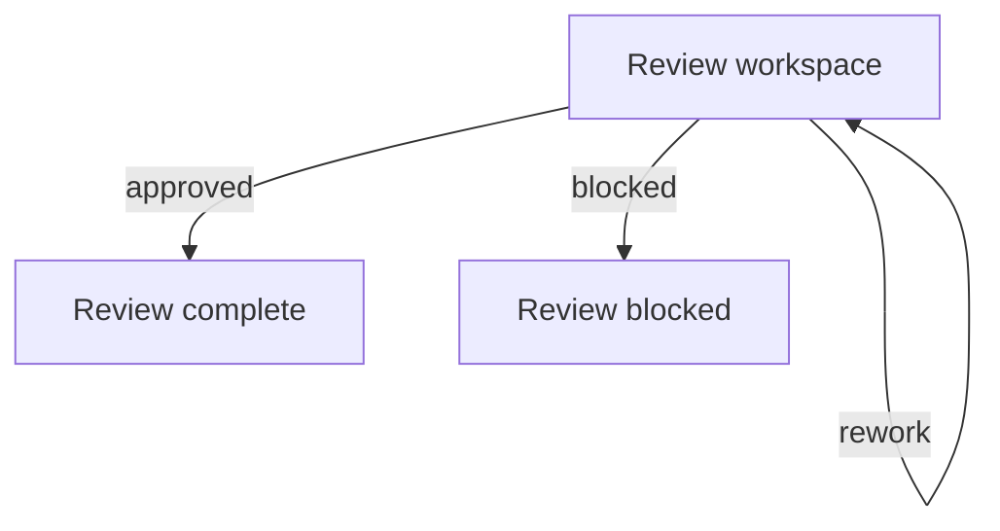

# Existing-agent review

Perform this task using the coding agent already working in the selected workspace.
Starting the workflow does not grant additional authorization.

```yaml merstride
schemaVersion: 1
id: agent_task
entry: review
nodes:
  review:
    kind: agent
    prompt: |
      Review the current workspace changes within the user's authorized scope.
      Return approved when ready, rework when another review is needed,
      or blocked when the task cannot be completed. Include a brief summary in data.
    context: [input, nodes.review.data]
  done:
    kind: end
    result: success
  stopped:
    kind: end
    result: failure
```


