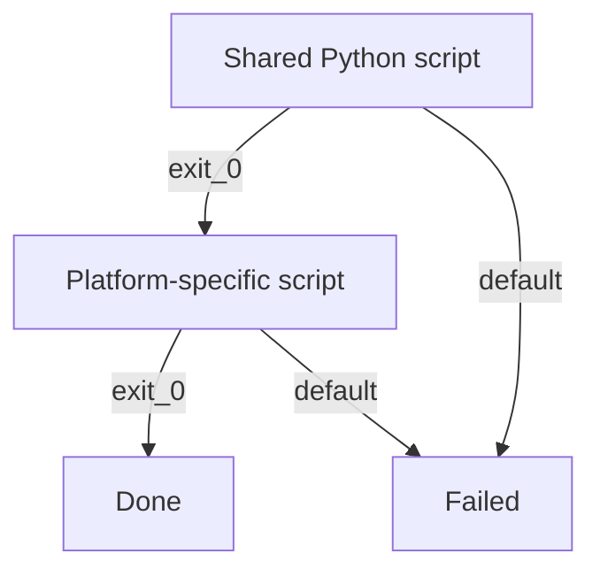

# Shared inline script and platform variants

Prerequisites for execution: Python 3 installed on PATH as `python` on each
platform, plus PowerShell 7 as `pwsh` on Windows or Bash as `bash` on macOS/Linux.
Merstride installs none of these. Validation needs no interpreter. Bash is one
explicit choice for this example, not an engine requirement. Adapt the shebang
to your installed executable names or quote an absolute/workspace-relative path.

The shared script has no platform condition and applies everywhere. The second
node names Windows separately from macOS/Linux. A variant without a condition
would apply everywhere and cannot coexist with another variant here.

```yaml merstride
schemaVersion: 1
id: portable
entry: shared
nodes:
  shared:
    kind: process
    timeoutSeconds: 10
    script: |
      #!/usr/bin/env -S python -X utf8 -
      from pathlib import Path
      print('Shared inline script: Grüße 🌍')
      print(Path.cwd())
  platform:
    kind: process
    timeoutSeconds: 10
    variants:
    - platforms: windows
      script: |
        #!pwsh -NoLogo -NoProfile -NonInteractive -Command -
        Write-Output 'Windows variant'
        Write-Output (Get-Location).Path
    - platforms: [macos, linux]
      script: |
        #!bash --noprofile --norc
        printf 'macOS/Linux variant\n'
        printf '%s\n' "$PWD"
  done:
    kind: end
    result: success
  failed:
    kind: end
    result: failure
```


