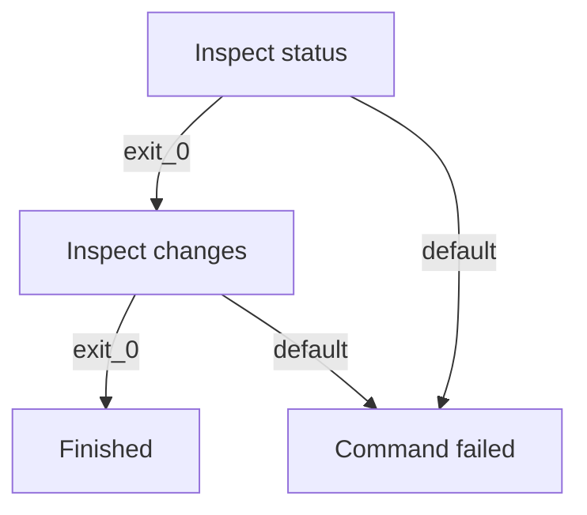

# Inspect a Git workspace

Run `start` with an existing Git repository as the absolute workspace, then `advance`.
Or use `start <file> --workspace <absolute-path> --advance` to create and perform
that first advance in one native invocation. Plain start executes nothing.
Both commands use Git explicitly and stream their output to the calling console.
Live text names **Inspect status** and **Inspect changes** in execution order and
ends with one summary. Use `--details` to see the numbered route and its reasons.
See the [recorded walkthrough](../docs/FLOW-OUTPUT.md).

```yaml merstride
schemaVersion: 1
id: inspect
entry: status
nodes:
  status:
    kind: process
    command: git
    args: [status, --short]
    timeoutSeconds: 30
  diff:
    kind: process
    command: git
    args: [diff, --stat]
    timeoutSeconds: 30
  done:
    kind: end
    result: success
  failed:
    kind: end
    result: failure
```


