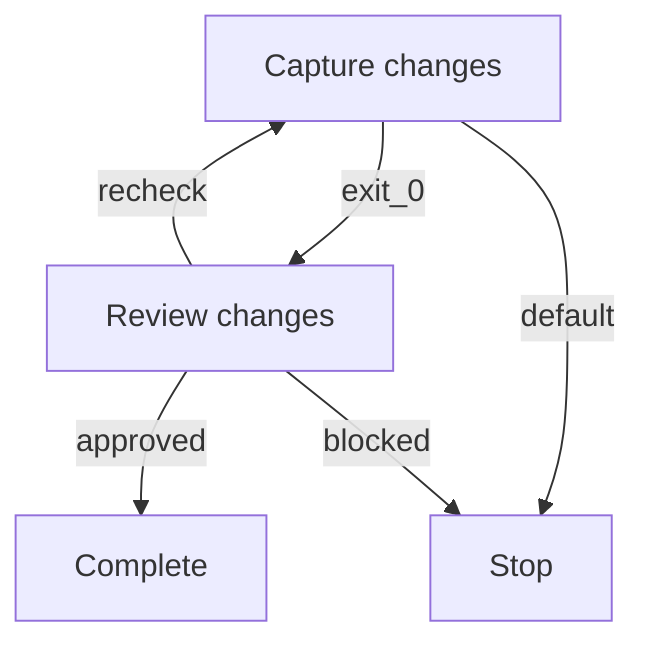

# Review changes

Requires Git in PATH and a Git repository as the workspace. This example captures status, delegates review to the existing agent, and supports rechecking after changes.

```yaml merstride
schemaVersion: 1
id: review_changes
entry: capture
limits:
  maxTransitions: 12
nodes:
  capture:
    kind: process
    command: git
    args: [status, --porcelain]
    timeoutSeconds: 30
  review:
    kind: agent
    prompt: |
      Review the changes in the workspace using your existing tools.
      Inspect actual diffs and relevant files; status alone is insufficient.
      Return recheck after authorized fixes, approved when review is complete,
      or blocked when you cannot continue. Summarize findings in data.
    context:
      - nodes.capture.exitCode
      - nodes.capture.stdoutTail
  done:
    kind: end
    result: success
  failed:
    kind: end
    result: failure
```


